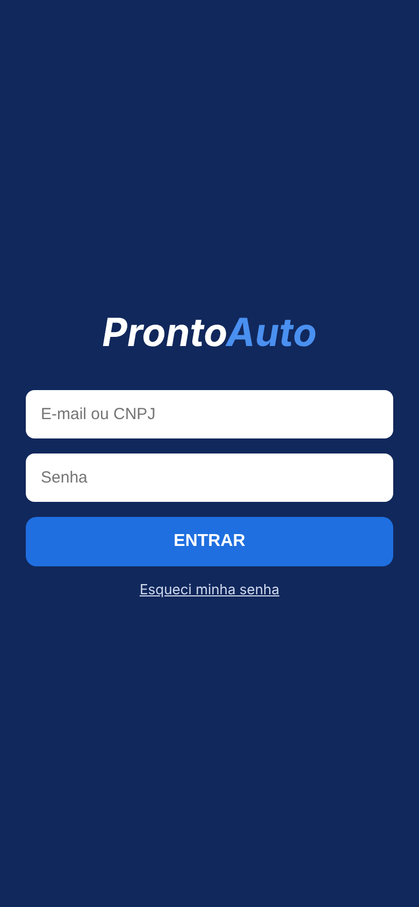
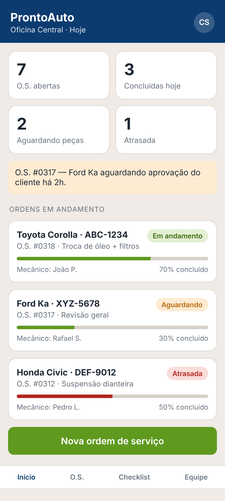
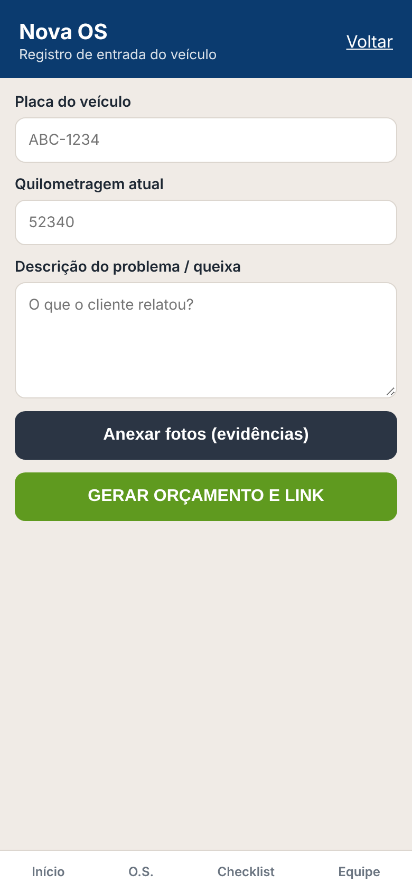
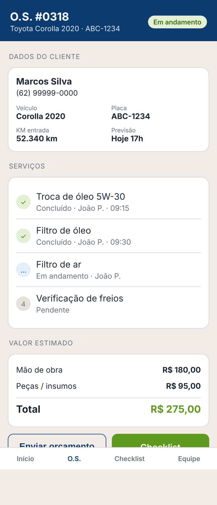
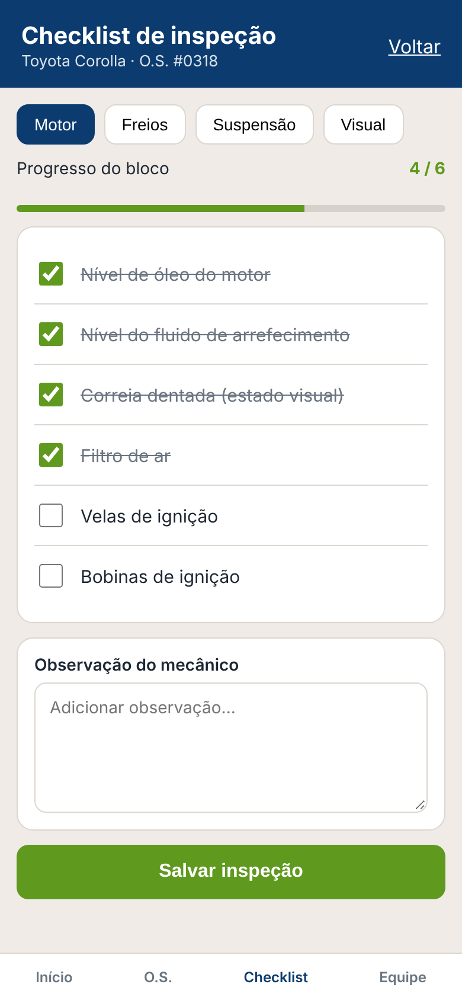
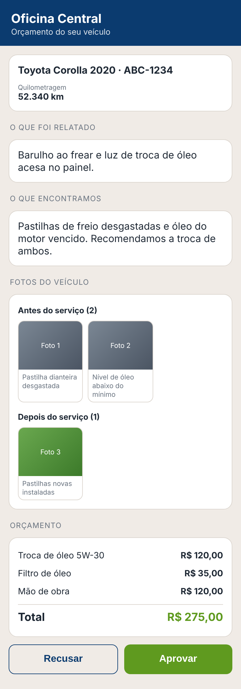

# ProntoAuto — Frontend

Aplicação web **mobile-first** para oficinas mecânicas registrarem ordens de serviço (OS), diagnósticos, evidências fotográficas e orçamentos, e compartilharem tudo com o cliente por um **link público** onde ele aprova ou recusa o orçamento — sem cadastro e sem senha.

> Projeto Integrador — Engenharia de Software, UniEVANGÉLICA (Anápolis/GO).

## O problema

Em muitas oficinas, diagnóstico, orçamento e autorização acontecem por mensagem ou ligação, sem registro organizado. Isso gera dúvidas sobre valores e serviços aprovados, conflitos e ausência de histórico de manutenção do veículo. O ProntoAuto organiza esse processo digitalmente: o mecânico registra queixa, fotos e itens do orçamento, e o cliente decide pelo celular com total transparência.

## Telas

| Login | Painel | Nova OS |
|:---:|:---:|:---:|
|  |  |  |

| Detalhes da OS | Checklist | Portal do cliente |
|:---:|:---:|:---:|
|  |  |  |

## Fluxos

**Oficina (área autenticada)**
1. Login com e-mail/CNPJ e senha.
2. Painel com indicadores do dia, aviso de OS aguardando aprovação e lista de ordens em andamento.
3. Nova OS: placa, quilometragem, queixa do cliente e fotos (abre a câmera do celular).
4. Detalhes da OS: dados do cliente e do veículo, serviços, valor estimado com total calculado.
5. Checklist de inspeção em quatro blocos (Motor, Freios, Suspensão e Visual), com progresso e observação.

**Cliente (portal público em `/view/:token`)**
1. Abre o link recebido — sem login.
2. Vê o veículo, o que foi relatado, o que a oficina encontrou, fotos *Antes* e *Depois* e o orçamento detalhado.
3. Aprova ou recusa (com motivo opcional); a página confirma a decisão com data e hora.

## Tecnologias

- [React 19](https://react.dev/) + [React Router 7](https://reactrouter.com/)
- [Vite 7](https://vite.dev/)
- JavaScript (JSX) e CSS puro com variáveis de estilo (sem biblioteca de componentes nem estado global)
- Fetch API nativa, concentrada na camada `services/`

## Como executar

Pré-requisito: [Node.js](https://nodejs.org/) 20.19 ou superior.

```bash
git clone <url-do-repositorio>
cd prontoauto-frontend
npm install
npm run dev
```

Acesse `http://localhost:5173/login`. Em modo simulado, qualquer e-mail/CNPJ e senha preenchidos entram. Para ver o portal do cliente, abra `http://localhost:5173/view/qualquer-token`.

| Comando | O que faz |
|---|---|
| `npm run dev` | Servidor de desenvolvimento (porta 5173) |
| `npm run build` | Gera a versão de produção em `dist/` |
| `npm run preview` | Serve localmente o build de produção |

## Dados simulados e integração com a API

Nesta fase a API ainda não existe: `src/services/api.js` define `USE_MOCK = true` e os serviços devolvem dados de exemplo. Para integrar o backend:

1. Copie `.env.example` para `.env` e ajuste `VITE_API_URL`.
2. Mude `USE_MOCK` para `false` em `src/services/api.js`.

Rotas já previstas pelos serviços:

| Método | Rota | Uso |
|---|---|---|
| POST | `/auth/login` | Login da oficina |
| GET / POST | `/os` | Listar / criar ordens de serviço |
| GET | `/os/:id` | Detalhes da OS |
| POST | `/os/:id/evidencias` | Upload de foto (Antes/Depois) |
| GET | `/portal/:token` | Dados da OS para o cliente |
| POST | `/portal/:token/decisao` | Aprovar ou recusar orçamento |

## Estrutura do projeto

```
src/
├── assets/styles/   estilos globais e variáveis visuais
├── components/      AppHeader, BottomNav, OSCard, StatusBadge, ProgressBar, BudgetSummary, EvidenceGallery
├── pages/           LoginPage, DashboardPage, NovaOSPage, OSDetalhePage, ChecklistPage, PortalClientePage
├── routes/          AppRoutes e ProtectedRoute (bloqueia rotas da oficina sem sessão)
├── services/        api, authService, osService, portalService
├── App.jsx
└── main.jsx
```

Nenhuma tela faz requisições diretamente: tudo passa por `services/` (RNF10), o que permite trocar os dados simulados pela API real em um único ponto. Os comentários no início dos arquivos indicam o requisito atendido (por exemplo, RF22 no login), facilitando a rastreabilidade com o documento de especificação.

## Arquitetura

Cliente-servidor em camadas: **frontend (React)** → **API backend (Node.js + TypeScript)** → **PostgreSQL** (dados) e **Supabase Storage** (fotos). O frontend nunca acessa banco ou storage diretamente. Regras de negócio como geração do token, decisão única por OS e atualização de status ficam no backend; o total do orçamento exibido no frontend serve apenas para apresentação.

> O backend está em desenvolvimento em repositório separado.

## Requisitos

Situação do frontend conforme o documento de especificação (v1.6):

- **Implementado:** RF02 (quilometragem), RF03 (queixa), RF08 (ver evidências), RF11 (total do orçamento), RF12 (link do cliente), RF13/RF36 (dados no portal), RF14/RF15/RF37 (aprovar/recusar), RF19/RF20/RF41 (motivo da recusa), RF22 (login), RF25 (criar OS), RF28 (anexar fotos), RF30/RF31 (Antes/Depois), RF35 (link com token).
- **Parcial:** RF07/RF29 (classificação Antes/Depois), RF09/RF10/RF32/RF33 (orçamento com múltiplos itens e total), RF16/RF17/RF38 (registro da decisão e data/hora), RF27 (estados da OS).
- **Planejado:** cadastro de oficina, cliente e veículo (RF01, RF21, RF23, RF24), mudança de status da OS (RF18, RF26, RF39), edição do orçamento (RF34), decisão como entidade própria (RF40) e persistência real, a cargo do backend.

Requisitos não funcionais tratados no frontend: interface responsiva com layout limitado a 480 px e centralizado em telas maiores (RNF01), linguagem simples no portal (RNF03), rota protegida (RNF05) e comunicação apenas via API (RNF10).

## Equipe

| Nome | Função |
|---|---|
| Dherick Bruçó Rodrigues | Desenvolvedor |
| Maxwell Anabil Macabeu da Silva | Product Owner |
| Edinelson Barbosa Filho | Desenvolvedor |
| Gustavo de Jesus Silva | Desenvolvedor |

**Orientadores:** Alvaro Lopes Bastos e William Pereira dos Santos Junior.

UniEVANGÉLICA — Curso de Engenharia de Software.
